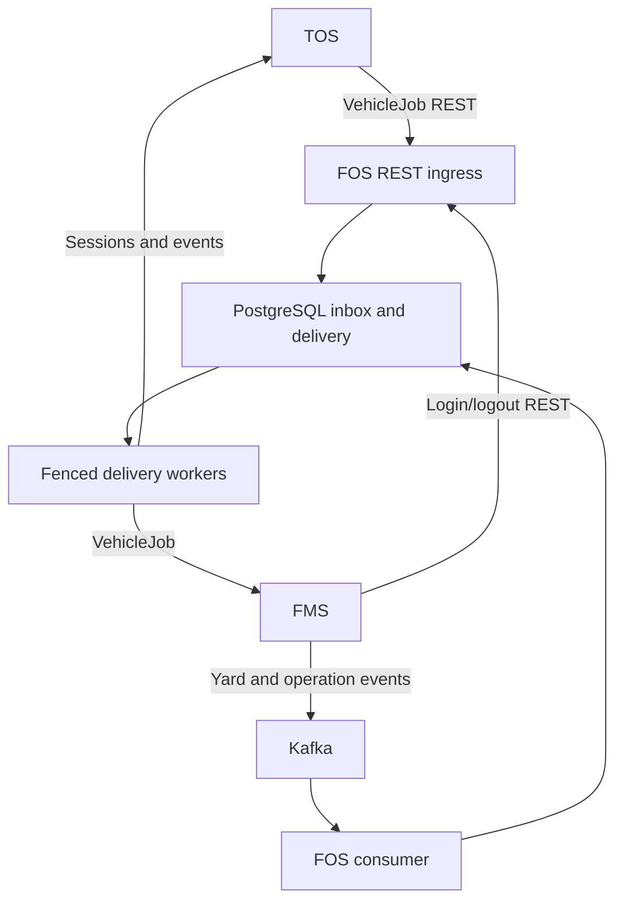
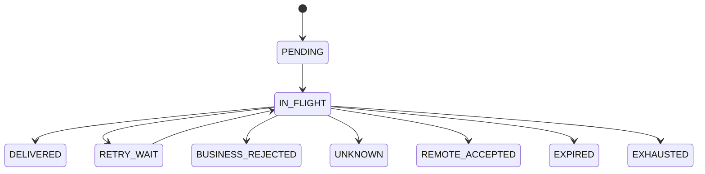

# Architecture and invariants

One Spring Boot process with explicit API, contract, application, adapter, persistence, security and configuration boundaries. No direct FMS-to-TOS integration, equipment control, scheduler, map, MQTT or event REST fallback.

## Acceptance and duplicate identity

The transaction inserts the inbox and initial delivery. PostgreSQL uniqueness serializes competing identical IDs. `ON CONFLICT DO NOTHING` waits for the competing insertion, then a separate statement reads the committed hash under READ COMMITTED. A conflicting hash does not modify the first record. Identical replay returns its receipt and current state. Arrival time is independent of source timestamp; forwarding preserves the original JSON and text timestamp.

The stream row increments a durable sequence inside acceptance. Stream identity is source/message type/vehicle. This is database acceptance order, not network arrival order or source event-time order. There is no global order across topics or types.

## Dispatcher

A claim transaction locks one eligible head row with `FOR UPDATE SKIP LOCKED`, increments the attempt and lease generation, then commits before HTTP. Finalization checks owner, generation, state and unexpired lease; attempt recording and state transition commit together. Expired leases become UNKNOWN, preventing an old worker from advancing the stream. A request may have completed remotely even when local finalization fails; receiver deduplication remains mandatory.

Separate bounded FMS and TOS thread pools have no work queue. Each receiver has a simple process-local circuit cooldown after five consecutive retry/unknown outcomes. A recovering receiver is retried after 30 seconds. This is not a cluster-wide rate limiter. Runtime metrics are low cardinality; no business IDs appear as labels.

All unresolved states block later stream entries. No automated callback/polling protocol is invented. UNKNOWN, REMOTE_ACCEPTED, EXPIRED and operation-status replay need counterpart reconciliation and a future approved resolution workflow.

## Kafka

Byte-array deserialization keeps poison JSON inside the durable quarantine path. Each consumer processes records synchronously on its consumer thread; manual immediate acknowledgment occurs only after the DB commit. A store failure throws; the error handler retries indefinitely without recovering/skipping or committing the failed offset. Successful redelivery after a crash is deduplicated. Quarantine identity is topic/partition/offset; oversized poison stores only hash and metadata. Topic ownership/ACLs establish the FMS source identity; client-supplied business user fields do not authenticate it.

## Retention

An opt-in bounded purge removes successful payloads after seven days, preserving immutable identity/hash/state. Legal hold and unresolved messages prevent purge. Tombstones, metadata and audit are currently kept indefinitely, deliberately avoiding unsafe deletion before replay/retention policy approval. Monitor storage growth; indefinite retention is a documented operational limitation, not the final policy.
